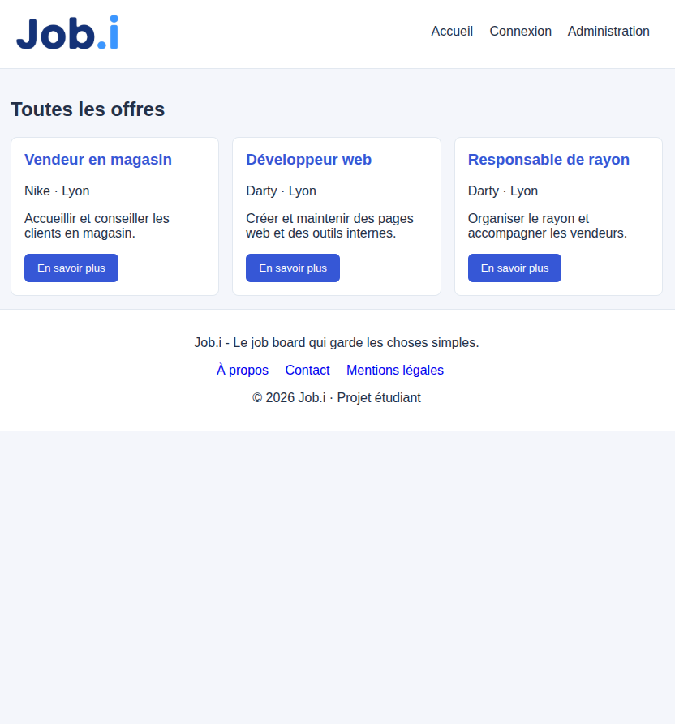

# Modifier le portfolio

## Ouvrir et voir ses modifications

Ouvre le dossier du site dans VS Code, puis `index.html` dans ton navigateur. Après une modification, sauvegarde avec Ctrl+S et actualise le navigateur.

## Retrouver les fichiers

| Fichier | Contenu |
| --- | --- |
| `index.html` | Accueil, citation, photo et menu principal |
| `projets.html` | Job Board, CV en ligne et portfolio |
| `parcours.html` | À propos, progression, technologies et sport |
| `contact.html` | Coordonnées et formulaire |
| `style.css` | Tous les styles, rangés en sections commentées |
| `app.js` | Ouverture d’un accordéon à partir d’un lien direct |
| `images/` | Portrait, captures et icônes |
| `documents/` | CV au format PDF |
| `README.md` | Présentation du projet, fonctionnement et publication |

## Changer un texte

Modifie le texte entre les balises, sans enlever les balises :

```html
<h1>Adrien CALVAYRAC<span>.</span></h1>
<p>Ma présentation.</p>
```

`span` permet de donner un style à une partie du texte. `br` fait un retour à la ligne. Les commentaires `<!-- ... -->` ne s’affichent pas dans le navigateur.

## Changer les couleurs et les tailles

Dans `style.css`, les couleurs sont écrites directement, sans variables CSS :

- `#f5efe5` : fond crème.
- `#32251d` : texte brun foncé.
- `#876537` : touches dorées et boutons.
- `#695949` : texte secondaire.

Ctrl+F trouve une couleur ou une classe. Utilise « Remplacer tout » si tu souhaites changer la même couleur partout.

```css
font-size: 36px; /* Taille du texte */
margin: 20px;   /* Espace autour */
padding: 20px;  /* Espace à l’intérieur */
gap: 30px;      /* Espace entre des éléments Flexbox */
```

## Photo et captures

Le portrait est `images/adrien.png`. Pour le remplacer, change ce fichier ou son adresse `src` dans `index.html`.

Les captures sont `images/job-board.png`, `images/cv-en-ligne.png` et `images/portfolio.png`. Chaque image porte un texte `alt` qui décrit son contenu : adapte aussi ce texte si l’image change.

Une image est cliquable lorsqu’elle est placée dans un lien :

```html
<a href="ADRESSE_DU_DEPOT" target="_blank" rel="noopener noreferrer">
    
</a>
```

Remplace `ADRESSE_DU_DEPOT` par la vraie adresse. `target="_blank"` demande un nouvel onglet ; les attributs `rel` protègent la page d’origine.

## CV et coordonnées

Le PDF est `documents/CV_Adrien_Calvayrac.pdf`. Le menu de l’accueil l’ouvre dans un nouvel onglet. Le lien de Contact utilise `download` pour proposer le téléchargement.

Les profils et l’adresse e-mail sont dans `index.html` et `contact.html`. Pense à changer les deux si tes coordonnées évoluent.

## Accordéons des projets

```html
<details class="projet-accordeon" name="projets" id="job-board">
    <summary><h2>Job Board</h2></summary>
    <!-- Contenu du projet -->
</details>
```

Le même `name="projets"` limite l’ouverture à un seul projet à la fois. Le navigateur gère ce fonctionnement, sans JavaScript. L’identifiant `id` permet un lien direct comme `projets.html#job-board`.

Le petit script `app.js`, chargé seulement par `projets.html`, ouvre le projet indiqué après le `#`. Les animations du menu et des captures restent en CSS.

## Formulaire

`contact.html` envoie les champs à Formspree avec `action="https://formspree.io/f/maeewdjg"` et `method="post"`. Les attributs `name` identifient le nom, l’adresse e-mail et le message. `required` rend les champs obligatoires.

Le destinataire est configuré dans le compte Formspree. Aucun mot de passe n’est présent dans le code. L’adresse d’envoi du formulaire est publique : ce n’est pas une clé secrète.

## Téléphone et animations

Le bloc `@media (max-width: 760px)` à la fin du CSS adapte la disposition aux petits écrans. Les colonnes s’empilent avec `flex-direction: column`.

`transition` rend les changements progressifs. `transform` déplace ou fait tourner un élément. `@keyframes apparition` définit l’animation d’entrée. Le dernier bloc respecte les personnes qui préfèrent réduire les animations.

Change une seule chose à la fois, sauvegarde, puis vérifie le résultat sur une fenêtre large et une fenêtre étroite.
